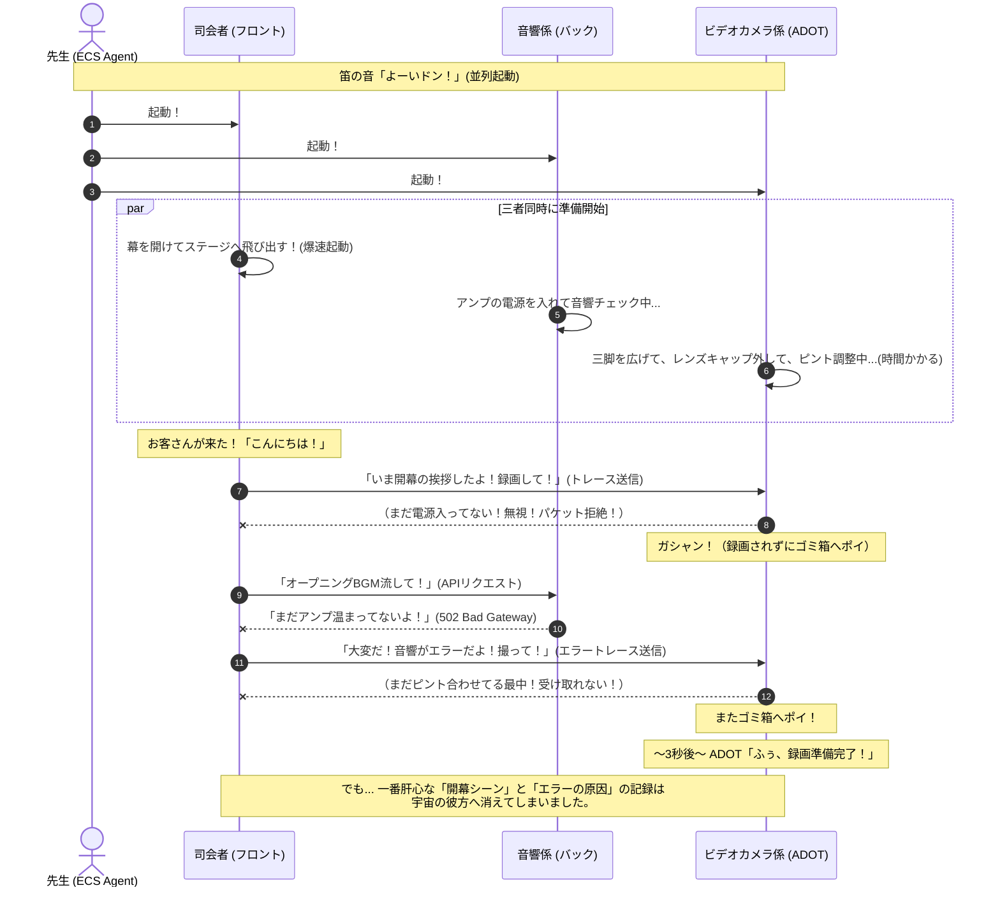
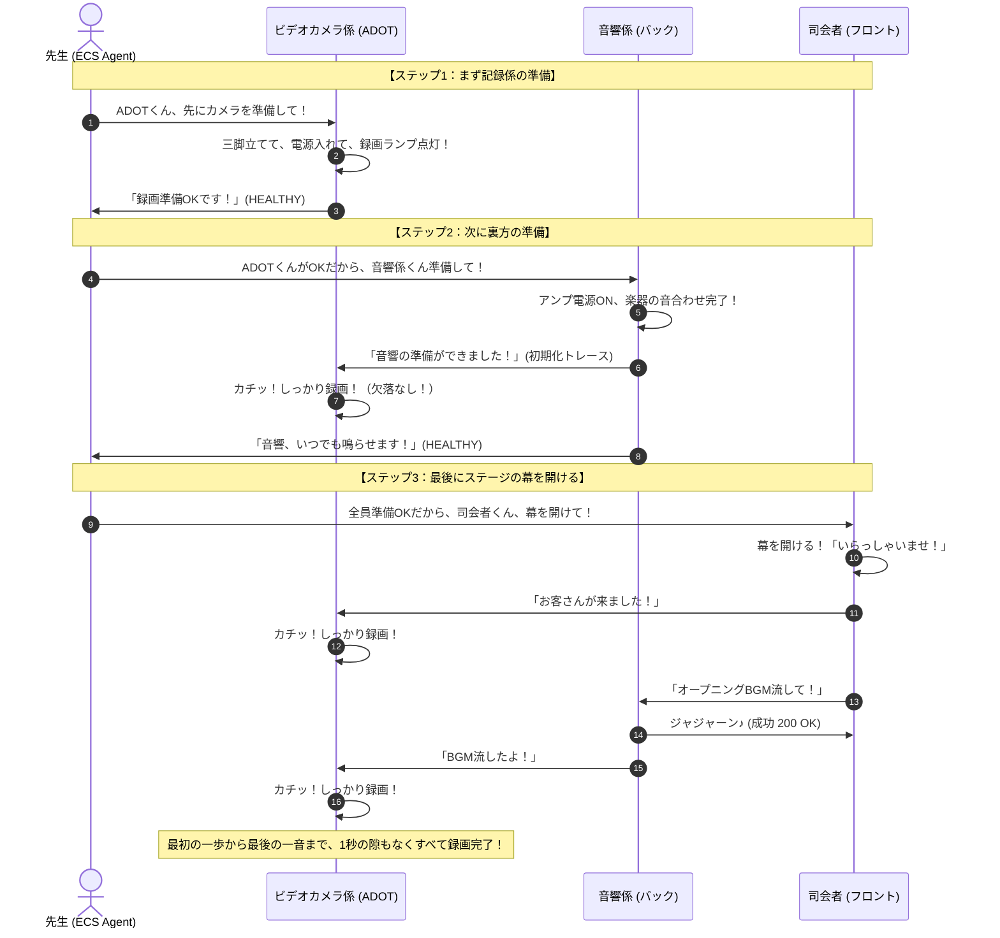
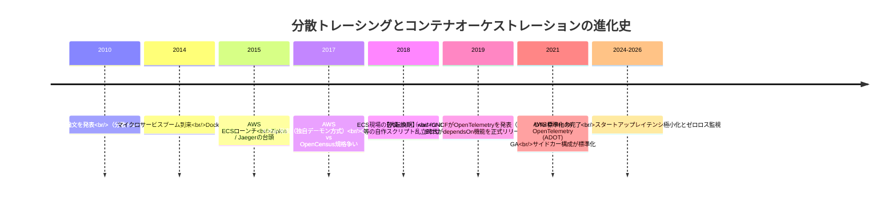
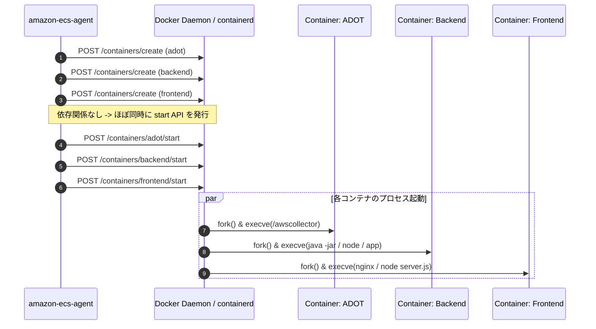
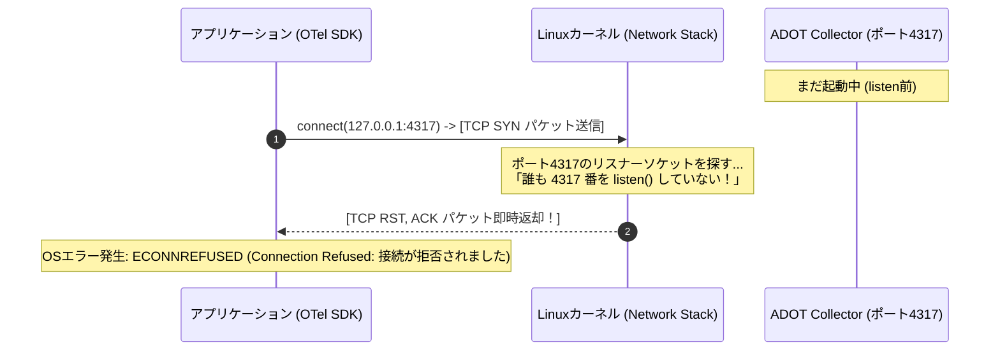

# ECSタスクの起動順（dependsOn）とADOTトレース欠落メカニズム完全ガイド
## 〜直列起動 vs 並列起動の深層・歴史的背景・小学生にもわかる図解から本番設定まで〜

---

## 目次

1. **はじめに：なぜ今、ECSタスクの起動順序とトレース欠落が問題になるのか？**
2. **【小学生にも絶対にわかる超明快な解説】学校の学芸会「まぼろしのビデオ撮影係」のお話**
   - 2.1 登場人物の紹介（ADOTカメラマン、裏方の音響係、ステージの司会者）
   - 2.2 「よーいドン！」の並列起動で起きる大パニック（開幕シーンが映っていない！？）
   - 2.3 「順番を守る」直列起動（dependsOn）の完璧なチームワーク
   - 2.4 小学生向け対比まとめ
3. **登場の歴史と背景：なぜ「ADOT」と「dependsOn」が必要になったのか？**
   - 3.1 モノリスからマイクロサービスへ（「1台の記録」から「旅するデータの追跡」へ）
   - 3.2 分散トレーシングの規格戦争と大同団結（Dapper → Zipkin/Jaeger → OpenTelemetryの誕生）
   - 3.3 AWS X-Ray デーモンから「ADOT（AWS Distro for OpenTelemetry）」への進化
   - 3.4 ECS初期（2015〜2019年）の苦悩：「wait-for-it.sh」シェルスクリプト地獄
   - 3.5 2019年末：ECSコンテナの依存関係制御（`dependsOn`）の登場
4. **動作原理と動作イメージの深堀り：なぜ並列起動だとトレースが消えるのか？**
   - 4.1 ECSタスクとネットワーク名前空間（`awsvpc` モードと `127.0.0.1` の物理構造）
   - 4.2 並列起動時のECS AgentとDocker Engineの動き（同時起動指令の真実）
   - 4.3 プロセス起動のミリ秒（ms）タイムライン比較
   - 4.4 OSカーネル・ネットワーク層で起きている物理現象（TCP SYN に対する RST、UDPパケットの消失）
   - 4.5 OpenTelemetry SDKの「フェイルサイレント（Fail-Silent）」設計思想とバッファ溢れ
   - 4.6 欠落する具体的なデータの正体（コールドスタート、DBマイグレーション、ALBヘルスチェック、初回トラフィック）
5. **直列起動（dependsOn）vs 並列起動（Parallel）徹底比較**
   - 5.1 構成パターンの比較（直列 vs 完全並列 vs 実務推奨ハイブリッド）
   - 5.2 比較マトリクス表（トレース完全性、起動所要時間、エラー検知性、設定複雑度）
   - 5.3 `dependsOn` の4つの条件（`START`, `COMPLETE`, `SUCCESS`, `HEALTHY`）
   - 5.4 【超重要】なぜ `START` ではダメで `HEALTHY` が必要なのか？
6. **本番環境で使える最新設定リファレンスと実装コード**
   - 6.1 ECSタスク定義（Task Definition）完全版 JSON（`dependsOn`, `healthCheck`, `startPeriod`）
   - 6.2 ADOT Collector設定（`otel-collector-config.yaml`）の `health_check` エクステンション
   - 6.3 `startPeriod`（猶予期間）の設計とベストプラクティス
   - 6.4 アプリケーション側（OTel SDK）のエクスポーター設定（バッファサイズとリトライ）
7. **トラブルシューティングと確認方法**
   - 7.1 トレース欠落が発生しているかをログとメトリクスから見破る方法
   - 7.2 現場でよくあるアンチパターンと回避策
8. **まとめ：信頼性の高いオブザーバビリティ基盤を構築するために**

---

## 1. はじめに：なぜ今、ECSタスクの起動順序とトレース欠落が問題になるのか？

AWS ECS（Elastic Container Service）上でモダンなWebアプリケーションを運用する際、**「分散トレーシング（Distributed Tracing）」** はもはや必須のインフラ技術です。ユーザーからの1つのリクエストが「フロントエンド（UI/API Gateway）」「バックエンド（マイクロサービス）」「データベース」へと伝播していく様子を可視化し、どこで遅延やエラーが発生しているかをミリ秒単位で追跡します。

AWSにおける分散トレーシングの標準コンポーネントが **「ADOT（AWS Distro for OpenTelemetry）」** です。ADOTは通常、アプリケーションコンテナと同じECSタスク内に **「サイドカーコンテナ」** として同居させます。

しかし、現場で非常によく見られるトラブルがあります：
> **「タスク起動直後の数秒間〜数十秒間、トレースが全く記録されない！」**
> **「コールドスタート時にエラーが発生した形跡があるのに、X-RayやCloudWatchコンソールを開いてもトレースが1件も存在しない！」**

この現象の真因こそが、**「ECSタスク内のコンテナ起動順序（dependsOn）の設定有無」** にあります。

コンテナを並列（一斉）に起動してしまうと、アプリケーションが動き出してトレースを送信しようとした瞬間に、受信側であるADOTの準備がまだ整っておらず、送信されたトレースが闇へと葬り去られてしまうのです。

本ドキュメントでは、この現象が発生する物理的な仕組み、ネットワークやOSカーネルレベルの動作原理、登場の歴史的経緯、そして本番環境でゼロ欠落を実現するための確実な設定方法を徹底的に解説します。

---

## 2. 【小学生にも絶対にわかる超明快な解説】学校の学芸会「まぼろしのビデオ撮影係」のお話

難しいIT用語を一旦すべて忘れて、小学校の学芸会（舞台劇）をイメージしてみましょう！

```
【登場人物の紹介】

① ADOTくん（ビデオカメラ係・記録係）
   ・役割：学芸会の様子を最初から最後までカメラで録画して、
           校長先生（CloudWatchやX-Ray）に提出する係。
   ・特徴：とても几帳面だけど、三脚を組み立てたり、テープを入れたり、
           レンズのピントを合わせるのに少し時間がかかる（起動に数秒かかる）。

② バックエンドくん（舞台裏の音響・照明・大道具係）
   ・役割：舞台裏でBGMを流したり、ライトをつけたり、背景を動かす裏方。
   ・特徴：フロントエンドくんから「音を鳴らして！」と頼まれてから動く。
           準備ができたら「いつでもOKだよ！」と合図を出す。

③ フロントエンドくん（ステージの司会者・主役）
   ・役割：一番最初にお客さん（ユーザー）の前に出て「いらっしゃいませ！」と挨拶し、
           バックエンドくんに合図を送る花形。
   ・特徴：足が速く、幕が開いたらすぐに話し始める。
```

---

### 2.1 「よーいドン！」の並列起動で起きる大パニック（開幕シーンが映っていない！？）

先生（ECS）が**「はい、時間です！みんな一斉に始めてください、よーいドン！」（並列起動）** と号令をかけました。

何が起きるでしょうか？



#### なぜ大失敗したの？
1. **司会者（フロント）** は足が速いので、すぐにステージに飛び出してお客さんと話し始めました。
2. 司会者は「いまお客さんと話したよ！」「音響係に合図したよ！」と、ビデオカメラ係のADOTくんに手を振って合図（トレース）を送りました。
3. ところが、**ADOTくんはまだ三脚を広げている最中** でした！カメラの電源すら入っていません。
4. 届かなかった合図は誰にも見られず、そのまま消えてしまいました（**これがトレースの欠落！**）。
5. しかも、音響係（バックエンド）もまだ準備中だったため、司会者が呼んでも音が出ずエラー（502エラー）になりました。
6. 学芸会が終わったあと、校長先生（エンジニア）が「最初のオープニングはどうして失敗したんだ？ビデオを見せてくれ！」と言いましたが、ビデオには**途中からしか映っておらず、最初の失敗の原因が永遠に迷宮入り**してしまいました。

---

### 2.2 「順番を守る」直列起動（dependsOn）の完璧なチームワーク

今度は、先生（ECS）が**「慌てないで、大切な順番を守って準備しましょう」（dependsOn による直列起動）** とルールを決めました。



#### うまくいった理由
- ADOTくんが**「録画ランプがついたよ！（HEALTHY）」** と合図を出すまで、他の係は絶対に動きません。
- だから、バックエンドが動き出した瞬間の音も、フロントエンドがお客さんを迎えた瞬間の一言目も、**最初から100%すべてカメラに記録** されました。

---

### 2.3 小学生向け対比まとめ

| 項目 | よーいドン！（並列起動） | 順番を守る（直列起動 dependsOn） |
| :--- | :--- | :--- |
| **たとえ** | 全員が一斉に走り出す運動会 | 前の人が準備できてからバトンを渡すリレー |
| **カメラマン（ADOT）** | 準備中にみんなが動き出して撮影失敗 | 完璧にカメラを構えてから合図を出す |
| **最初の記録（トレース）** | **消えてなくなる（欠落する）** | **最初の一言から全部残る（完全記録）** |
| **最初のトラブル** | なぜ失敗したかビデオに残らず原因不明 | トラブルの一部始終が克明に残る |
| **全体の準備時間** | 一見すると少し早く見える | 順番を待つ分、数秒だけ長くかかる |
| **安心感・信頼性** | × いつ大事故が起きるか分からない | ◎ いつでも確実に動いて記録が残る |

---

## 3. 登場の歴史と背景：なぜ「ADOT」と「dependsOn」が必要になったのか？

なぜ現代のクラウド開発において、このようなコンテナの起動順序やトレーシングの仕組みが必要不可欠になったのでしょうか？その歴史を紐解くと、インフラとオブザーバビリティ（可観測性）の劇的な進化の物語が見えてきます。



---

### 3.1 モノリスからマイクロサービスへ（「1台の記録」から「旅するデータの追跡」へ）

- **2010年代初頭（モノリス時代）**:
  Webシステムは1台の大きな仮想マシン（EC2）上で1つの巨大なアプリケーション（Ruby on Rails, Java EE, Django等）が動いていました。
  ログはローカルの `/var/log/app.log` に書き出され、エラーが起きればSSHでログインして `grep` コマンドで調査できました。起動順序に悩む必要もありませんでした。
- **2014年以降（マイクロサービス時代）**:
  Dockerコンテナの登場により、巨大なシステムは何十・何百もの小さな「マイクロサービス」に分割されました。
  1人のユーザーが「購入ボタン」を押すと、リクエストは **API Gateway → フロントエンドコンテナ → 認証サービス → 注文サービス → 在庫サービス → 決済サービス → 配送サービス** とネットワークを越えて駆け巡ります。
  このとき、どこか1箇所で遅延やエラーが発生した場合、従来の「バラバラのログ」では原因の特定が不可能になりました。そこで生まれたのが、リクエストごとに一意のID（Trace ID）を付与してバトンリレーのように追跡する **「分散トレーシング（Distributed Tracing）」** です（起源は2010年のGoogle Dapper論文）。

---

### 3.2 分散トレーシングの規格戦争と大同団結（Dapper → OpenTelemetry）

分散トレーシングを普及させる過程で、激しい規格争いが起きました：
1. **OpenTracing（CNCF）**: API仕様のみを標準化しようとしたプロジェクト。
2. **OpenCensus（Google発）**: APIだけでなく実装ライブラリやメトリクス収集まで包括したプロジェクト。

二大派閥に分裂し、開発者は「どちらのライブラリを使えばいいのか？」という混乱に陥りました。
この分断を解消するため、2019年5月に両プロジェクトが電撃的に合併し、CNCF（Cloud Native Computing Foundation）のもとで誕生したのが **「OpenTelemetry（通称 OTel）」** です。
現在、OpenTelemetryはKubernetesに次ぐCNCF第2位のアクティブなコントリビューター数を誇り、オブザーバビリティの世界標準（デファクトスタンダード）となりました。

---

### 3.3 AWS X-Ray デーモンから「ADOT」への進化

AWSも当初は独自の分散トレーシングサービスとして **AWS X-Ray** を提供し、専用の「X-Ray デーモン（xray-daemon）」をコンテナとして動かしていました。
しかし、専用エージェントには以下の課題がありました：
- ベンダーロックインが発生し、将来DatadogやDynatrace、Grafana Tempo等へ移行するのが困難。
- X-Ray独自のプロトコル（UDP 2000番ポート）やSDKが必要。

そこでAWSはOpenTelemetryプロジェクトに全面的にコミットすることを決断し、2020年に **「ADOT（AWS Distro for OpenTelemetry）」** を発表しました（2021年本番GA）。
ADOT Collectorは、アップストリームのOpenTelemetry Collectorに、AWS環境（X-Ray, CloudWatch, OpenSearch, ECS, EKS）で動作するための認証や最適化エクスポーターを組み込んだ「AWS公式サポートのコレクター」です。

---

### 3.4 ECS初期（2015〜2019年）の苦悩：「wait-for-it.sh」シェルスクリプト地獄

2015年にAWS ECSが発表されたとき、1つのECSタスクの中に複数のコンテナを定義できる「タスク定義（Task Definition）」が導入されました。
これにより、メインアプリの横にログ収集（Fluentd/Fluent Bit）やトレース収集（X-Ray/ADOT）を置く **「サイドカーパターン」** が普及しました。

しかし、当時のECSには致命的な欠落がありました：
> **「タスク定義内のすべてのコンテナは、完全に同時に（並列に）起動するしかなかった！」**

起動順序を制御する機能がなかったため、当時のインフラエンジニアは血のにじむようなハックを行っていました：
- DockerfileのENTRYPOINTに `wait-for-it.sh` や `dockerize` というシェルスクリプトを仕込む。
- メインアプリの起動前に、ループ処理で `nc -z localhost 2000` や `curl http://localhost:8080/health` を数十回叩いて、サイドカーやDBのポートが開くまで無理やり `sleep 1` で待機させる。
- シェルスクリプトのエラー処理が甘いと、コンテナがゾンビ化したり、タイムアウトでコンテナが強制終了して再起動ループ（CrashLoopBackOff）に陥る。

---

### 3.5 2019年末：ECSコンテナの依存関係制御（`dependsOn`）の登場

世界中のエンジニアからの熱烈な要望を受け、**2019年11月、AWSはついにECSにおける「コンテナの依存関係（Container Dependency: `dependsOn`）」を正式リリース** しました。

これにより、自作の待機スクリプトを書くことなく、タスク定義のJSON/Terraform上で「ADOTが準備完了（HEALTHY）になるまで、バックエンドは起動待機する」「バックエンドが準備完了（HEALTHY）になるまで、フロントエンドは起動待機する」という厳密な依存関係を宣言的に書けるようになったのです。

---

## 4. 動作原理と動作イメージの深堀り：なぜ並列起動だとトレースが消えるのか？

ここからは、エンジニアリングの深層に踏み込みます。
なぜ並列起動だとトレースが欠落するのか？Linuxカーネル、ネットワーク名前空間、プロセス起動シーケンス、ソケットプログラミングの物理的挙動をミリ秒単位で解き明かします。

---

### 4.1 ECSタスクとネットワーク名前空間（`awsvpc` モードの物理構造）

AWS ECS（特にAWS FargateやモダンなEC2起動タイプ）では、ネットワークモードとして **`awsvpc`** を使用するのがベストプラクティスです。

```
+-----------------------------------------------------------------------------------+
| ECS タスク (Task)                                                                 |
|   同一の Network Namespace (ネットワーク名前空間) を共有                           |
|   同一の ENI (Elastic Network Interface) / 単一のプライベートIP (例: 10.0.1.50)      |
|                                                                                   |
|  +----------------------+  +-----------------------+  +------------------------+  |
|  | フロントエンドコンテナ  |  |  バックエンドコンテナ   |  |   ADOTサイドカーコンテナ  |  |
|  | (ポート: 80 / 3000)  |  |  (ポート: 8080)       |  |   (受信ポート: 4317/4318)  |  |
|  +----------+-----------+  +-----------+-----------+  +-----------+------------+  |
|             |                          |                          |               |
|             +--------------------------+--------------------------+               |
|                                        |                                          |
|                          Loopback Interface (lo)                                  |
|                          アドレス: 127.0.0.1 (localhost)                          |
+-----------------------------------------------------------------------------------+
```

- **`awsvpc` の特徴**:
  タスク内のすべてのコンテナは **「同じネットワーク名前空間（Network Namespace）」** を共有しています。
  そのため、コンテナ間の通信は外部ネットワークを経由せず、すべて **ローカルループバックインターフェース（`127.0.0.1` / `localhost`）** を通じて行われます。
- フロントエンドやバックエンドのアプリケーションに組み込まれたOpenTelemetry SDKは、トレースの送信先として `http://localhost:4317`（gRPC）や `http://localhost:4318`（HTTP）を指定します。

---

### 4.2 並列起動時のECS AgentとDocker Engineの動き

`dependsOn` を指定しない場合、ECSタスクを管理するホスト上の `amazon-ecs-agent` は、Docker Engineに対してすべてのコンテナの作成と起動を一気に指示します。



このとき、Dockerの `start` APIが完了した瞬間（PIDが払い出された瞬間）から、各コンテナ内のOSプロセスがそれぞれのペースで立ち上がります。ここに **「起動速度の決定的な不均衡（レースコンディション）」** が発生します。

---

### 4.3 プロセス起動のミリ秒（ms）タイムライン比較

各コンテナが起動してから通信を受け付けられるようになるまでの「内部処理の重さ」を比較してみましょう。

```
【ADOT Collector の起動シーケンス (合計所要時間: 約 1,500ms 〜 3,500ms)】
T=0ms       : プロセス生成 (execve)
T=100ms     : Goランタイム初期化、メモリ割り当て
T=300ms     : 設定ファイル (/etc/ecs/otel-config.yaml) の読み込み・YAML構文解析
T=600ms     : 各種 Extensions (health_check 等) の初期化
T=900ms     : Exporters (AWS X-Ray, CloudWatch, OTLP) の初期化・AWS認証情報(IAM Role)の解決
T=1,500ms   : Processors (batch, memory_limiter) の起動
T=2,000ms   : Receivers (OTLP gRPC:4317, HTTP:4318) の初期化
T=2,500ms   : ★カーネルシステムコール bind() & listen() を呼び出し、ポートが開く！
T=2,600ms   : 受信待機ループ (accept) 開始

【バックエンド / フロントエンド の起動シーケンス (軽量Go/Nodeの場合: 約 200ms 〜 800ms)】
T=0ms       : プロセス生成
T=150ms     : ランタイム初期化
T=300ms     : OTel SDK 初期化 (TracerProvider生成)
T=400ms     : アプリ起動処理 (DB接続、設定ロード、初期化ログ生成)
T=500ms     : ★起動時の初期化トレースを localhost:4317 に向けて送信！！
              ---> しかし ADOT はまだ「T=500ms (設定ロード中)」！ポートが開いていない！
```

---

### 4.4 OSカーネル・ネットワーク層で起きている物理現象

バックエンドやフロントエンドが、ADOTがポートを開く前（T=500ms）にトレースを送信すると、OSのカーネル内部では何が起きているのでしょうか？



#### 1. TCP / gRPC（ポート 4317 / 4318）の場合
- アプリケーション側のOpenTelemetry SDKは、`127.0.0.1:4317` に対してTCPの接続要求（`SYN` パケット）をループバックインターフェースに送信します。
- LinuxカーネルはTCPソケットテーブルを参照しますが、この時点でポート 4317 を `listen()` しているプロセスは存在しません。
- カーネルのTCPスタックは即座に **`RST`（Reset）フラグを立てたパケットを返却** します。
- アプリケーション側にはシステムコールレベルで **`ECONNREFUSED`（Connection refused: 接続が拒否されました）** エラーが返されます。

#### 2. UDP（ポート 2000：旧X-Rayデーモン互換モード等の場合）
- UDPはコネクションレスのプロトコルであるため、送信側は相手がいるかどうかを確認せずにパケットを送出します。
- カーネルは受信プロセスがいないポート宛てのUDPパケットを受け取ると、破棄（Drop）するか、カーネル内部でICMP Port Unreachableを生成しますが、UDPクライアント側は通常それを無視します。
- つまり、**パケットは文字通り「完全な無音（サイレント）」で闇に消えます**。

---

### 4.5 OpenTelemetry SDKの「フェイルサイレント（Fail-Silent）」設計思想とバッファ溢れ

ここで非常に重要な疑問が浮かびます：
> **「接続エラー（ECONNREFUSED）が起きたなら、なぜアプリはクラッシュしたり例外エラー画面を出したりしないのか？」**

これこそが、OpenTelemetry SDKの根幹にある **「フェイルサイレント（Fail-Silent / Non-Blocking）設計原則」** です。

```
【可観測性ツールの鉄則】
「監視ツールの不具合によって、本番の業務アプリケーションを絶対に巻き添えにして落としてはならない！」
```

OpenTelemetry SDKはこの鉄則に従い、以下のように動作します：

```mermaid
flowchart TD
    Req[ビジネスロジックの実行 / トレース生成] --> Span[Spanデータの作成]
    Span --> Queue{BatchSpanProcessor<br/>メモリキュー}
    
    Queue -- キューに空きあり --> Push[内部バッファに蓄積]
    Queue -- キュー満杯 --> Drop1[★即座に破棄 (Buffer Overflow Drop)]
    
    Push --> AsyncWorker[バックグラウンド非同期スレッド]
    AsyncWorker --> Export[Exporter: localhost:4317へ送信]
    
    Export -- 接続失敗 (ECONNREFUSED) --> RetryCheck{リトライ上限超過<br/>またはタイムアウト?}
    RetryCheck -- 未超過 --> Sleep[少し待って再試行]
    RetryCheck -- 超過 --> Drop2[★データをゴミ箱へ破棄 (Fail-Silent Drop)]
    
    Drop1 -.-> Silent[アプリの処理はそのまま正常継続<br/>(ユーザーにはエラーが見えない)]
    Drop2 -.-> Silent
```

1. **非同期バッファリング**:
   メインスレッドはブロックされず、生成されたスパンはメモリ上のリングバッファ（`BatchSpanProcessor`）に一旦放り込まれます。
2. **バックグラウンド送信の失敗**:
   裏で動くワーカースレッドがADOTへ送信しようとしますが、`Connection Refused` になります。
3. **バッファの枯渇と破棄（Drop）**:
   メモリを無制限に食いつぶしてアプリがOOM（Out of Memory）で死ぬのを防ぐため、バッファサイズには上限（例: デフォルトで 2048 スパンなど）が設けられています。
   ADOTが立ち上がらない間、バッファは一瞬で溢れ、**古いトレースから順に警告ログを出すこともなく静かに破棄（Drop）** されます。

---

### 4.6 欠落する具体的なデータの正体

並列起動によって欠落してしまうトレースには、**「システム運用上、最も価値の高いデータ」** が含まれています。

1. **コールドスタート時の初期化トレース**:
   - データベースの初期コネクションプール確立にかかった時間
   - AWS Systems Manager Parameter Store や Secrets Manager からの環境変数・暗号鍵の取得遅延
   - Spring Boot や Rails 等のフレームワーク初期化処理の遅延
2. **ALB（Application Load Balancer）の初回ヘルスチェックトレース**:
   - 新しいタスクが立ち上がった際、ALBから届く最初の `/healthz` リクエスト。これがなぜ遅いのか、なぜ失敗したのかの証拠。
3. **デプロイ直後のユーザーからの最初のリクエスト（初回アクセス）**:
   - オートスケーリングで新規起動したタスクに初めてルーティングされたユーザーの通信。
   - JITコンパイルやキャッシュが温まっていないため最もレイテンシが悪化しやすい部分であるにもかかわらず、そこだけ綺麗に観測から抜け落ちます。

---

## 5. 直列起動（dependsOn）vs 並列起動（Parallel）徹底比較

ここでは、「ADOT → バックエンド → フロントエンド」の完全直列起動と、並列起動、さらには実務で最もバランスの取れた推奨ハイブリッド構成を比較検討します。

---

### 5.1 構成パターンの比較

```
【パターンA: 完全直列構成 (Serial with dependsOn)】
  [ADOT (HEALTHY)]  ===(dependsOn)===>  [Backend (HEALTHY)]  ===(dependsOn)===>  [Frontend (HEALTHY)]
  ・ADOTが完全に立ち上がって健康診断を通るまでバックエンドは起動しない。
  ・バックエンドが完全に立ち上がって健康診断を通るまでフロントエンドは起動しない。

【パターンB: 完全並列構成 (Parallel / No dependsOn)】
  [ADOT]       (T=0 同時起動)
  [Backend]    (T=0 同時起動)
  [Frontend]   (T=0 同時起動)
  ・レースコンディション発生。トレース欠落、およびフロントからバックへの502エラーが多発。

【パターンC: 実務推奨ハイブリッド構成 (Recommended Production Hybrid)】
  [ADOT (HEALTHY)] ──+===(dependsOn)===> [Backend (HEALTHY)] ──+===(dependsOn)===> [Frontend]
                     |                                         |
                     +=========================================+
  ・ADOTが健康（HEALTHY）になるまで、BackendもFrontendも起動しない。
  ・Backendが健康になってからFrontendを起動（タスク外からのアクセス受付を開始）。
```

---

### 5.2 比較マトリクス表

| 評価項目 | パターンA: 完全直列起動 | パターンB: 完全並列起動 | パターンC: 推奨ハイブリッド |
| :--- | :--- | :--- | :--- |
| **トレース欠落リスク** | **ゼロ（100% 収集保証）** | **極めて高い（初期数秒〜数十秒欠落）** | **ゼロ（100% 収集保証）** |
| **タスク起動所要時間** | 長い（各コンテナの起動時間の総和） | 最短（最も遅いコンテナの起動時間） | 中間（ADOT起動時間 ＋ アプリ起動時間） |
| **起動時 502/接続エラー** | 完全に防止（依存先が必ず存在） | 多発（フロントがバックより早く起動） | 完全に防止 |
| **初期障害の調査容易性** | ◎ 完全なトレースで即座に原因特定可能 | × トレースが存在せず「盲目」状態 | ◎ 完全なトレースで即座に原因特定可能 |
| **設定の複雑さ** | 中（ヘルスチェックと依存関係の定義） | 低（何も書かない） | 中（実務での標準的設計） |
| **推奨ユースケース** | 堅牢性を最優先するミッションクリティカル基盤 | 使い捨てのバッチ処理等（トレース不要時） | **一般的な本番Web/APIサービス** |

---

### 5.3 `dependsOn` の4つの条件（`condition`）

ECSの `dependsOn` では、依存先コンテナに対して以下の4つの条件（condition）を指定できます。

| 条件名 | 意味 | 到達判定のトリガー | トレース収集用途での評価 |
| :--- | :--- | :--- | :--- |
| **`START`** | 依存先コンテナが起動した | Dockerがプロセスを生成（PID払い出し）した瞬間 | **× 危険（ポート未開通のため欠落する）** |
| **`COMPLETE`** | 依存先コンテナが終了した | プロセスが終了（正常・異常問わず）した瞬間 | × サイドカーは常駐するため不適 |
| **`SUCCESS`** | 依存先コンテナが正常終了した | 終了ステータスコードが `0` で終了した瞬間 | × DBマイグレーション用コンテナ等で使用 |
| **`HEALTHY`** | 依存先コンテナが健全である | `healthCheck` コマンドが成功（コード0）を返した | **◎ 必須（ポート開通・受信準備完了を保証）** |

---

### 5.4 【超重要】なぜ `START` ではダメで `HEALTHY` が必要なのか？

初級〜中級のエンジニアが最もハマりやすい落とし穴がこれです：
> **「タスク定義に `dependsOn` を追加して condition を `START` にしたのに、まだトレースが欠落する！」**

```
【START の盲点】
ECS Agent が「START」と判定するのは、Docker Engineが execve() システムコールを実行して
プロセスID (PID) を作成した「T = 100ms」の瞬間です。

しかし、前述の通り、ADOT Collector が設定ファイルを読み込み、
受信ポート (4317) を listen() してリクエストを受け付けられるようになるのは
「T = 2,500ms」です！

「START」にした場合:
T=100ms でバックエンドの起動が許可されてしまうため、
2,500ms までの約 2.4秒間に発生したトレースは依然として全て欠落します！
```

したがって、**ADOTコンテナに対する dependsOn の条件は、必ず `HEALTHY` にしなければなりません**。

---

## 6. 本番環境で使える最新設定リファレンスと実装コード

ここからは、実際に本番環境でそのまま利用できる設定コードを提供します。

---

### 6.1 ECSタスク定義（Task Definition）完全版 JSON

```json
{
  "family": "production-service-task",
  "networkMode": "awsvpc",
  "requiresCompatibilities": ["FARGATE"],
  "cpu": "1024",
  "memory": "2048",
  "containerDefinitions": [
    {
      "name": "adot-collector",
      "image": "public.ecr.aws/aws-observability/aws-otel-collector:latest",
      "essential": true,
      "command": ["--config=/etc/ecs/ecs-default-config.yaml"],
      "healthCheck": {
        "command": [
          "CMD-SHELL",
          "curl -f http://localhost:13133/ || exit 1"
        ],
        "interval": 5,
        "timeout": 2,
        "retries": 3,
        "startPeriod": 10
      },
      "logConfiguration": {
        "logDriver": "awslogs",
        "options": {
          "awslogs-group": "/ecs/adot-collector",
          "awslogs-region": "ap-northeast-1",
          "awslogs-stream-prefix": "ecs"
        }
      }
    },
    {
      "name": "backend-service",
      "image": "123456789012.dkr.ecr.ap-northeast-1.amazonaws.com/backend:latest",
      "essential": true,
      "dependsOn": [
        {
          "containerName": "adot-collector",
          "condition": "HEALTHY"
        }
      ],
      "healthCheck": {
        "command": [
          "CMD-SHELL",
          "curl -f http://localhost:8080/healthz || exit 1"
        ],
        "interval": 5,
        "timeout": 2,
        "retries": 3,
        "startPeriod": 15
      },
      "environment": [
        { "name": "OTEL_EXPORTER_OTLP_ENDPOINT", "value": "http://127.0.0.1:4317" },
        { "name": "OTEL_SERVICE_NAME", "value": "backend-service" }
      ],
      "portMappings": [
        {
          "containerPort": 8080,
          "protocol": "tcp"
        }
      ]
    },
    {
      "name": "frontend-service",
      "image": "123456789012.dkr.ecr.ap-northeast-1.amazonaws.com/frontend:latest",
      "essential": true,
      "dependsOn": [
        {
          "containerName": "adot-collector",
          "condition": "HEALTHY"
        },
        {
          "containerName": "backend-service",
          "condition": "HEALTHY"
        }
      ],
      "healthCheck": {
        "command": [
          "CMD-SHELL",
          "curl -f http://localhost:80/ || exit 1"
        ],
        "interval": 5,
        "timeout": 2,
        "retries": 3,
        "startPeriod": 10
      },
      "environment": [
        { "name": "OTEL_EXPORTER_OTLP_ENDPOINT", "value": "http://127.0.0.1:4317" },
        { "name": "BACKEND_API_URL", "value": "http://127.0.0.1:8080" }
      ],
      "portMappings": [
        {
          "containerPort": 80,
          "protocol": "tcp"
        }
      ]
    }
  ]
}
```

---

### 6.2 ADOT Collector設定（`otel-collector-config.yaml`）

ADOT Collector側では、`health_check` エクステンションを有効化しておく必要があります（デフォルト設定でも 13133 番ポートで有効化されていることが多いですが、カスタム設定を使用する場合は明示します）。

```yaml
extensions:
  health_check:
    endpoint: 0.0.0.0:13133

receivers:
  otlp:
    protocols:
      grpc:
        endpoint: 0.0.0.0:4317
      http:
        endpoint: 0.0.0.0:4318

processors:
  batch:
    timeout: 1s
    send_batch_size: 1024
  memory_limiter:
    check_interval: 1s
    limit_percentage: 75
    spike_limit_percentage: 20

exporters:
  awsxray:
    region: ap-northeast-1

service:
  extensions: [health_check]
  pipelines:
    traces:
      receivers: [otlp]
      processors: [memory_limiter, batch]
      exporters: [awsxray]
```

---

### 6.3 `startPeriod`（ヘルスチェック猶予期間）の設計とベストプラクティス

タスク定義の `healthCheck` に含まれる **`startPeriod`** は、非常に重要かつ見落とされがちなパラメータです。

- **`startPeriod` とは**:
  コンテナが起動してから初期化を終えるまでの「猶予時間（秒）」です。
  この秒数内に実行されたヘルスチェックが失敗（exit 1）しても、**ECSはリトライ失敗回数（retries）としてカウントしません**。
- **なぜADOTやアプリに必要なのか？**:
  もし `startPeriod` を設定しない場合、コンテナ起動からわずか数秒でヘルスチェックが走り、初期化途中のADOTが「失敗」と判定されます。
  `retries: 3` の場合、15秒足らずでコンテナが「UNHEALTHY」とみなされ、タスク全体が強制停止・再起動ループに陥ってしまいます。
- **推奨値**:
  - ADOT Collector: `startPeriod: 10`（通常は2〜3秒で立ち上がるため10秒で十分）
  - Java / Spring Boot などの重いバックエンド: `startPeriod: 30` 〜 `60`
  - Node.js / Go / Nginx: `startPeriod: 10` 〜 `15`

---

### 6.4 アプリケーション側（OTel SDK）のエクスポーター設定

万が一のネットワーク揺らぎに備え、アプリケーション側のOpenTelemetry SDKでもバッファとリトライを適切に調整しておきます。

```bash
# 環境変数による設定例（OpenTelemetry標準仕様）
OTEL_BSP_MAX_QUEUE_SIZE=4096            # バッファキューの最大スパン数（デフォルト2048より少し増やす）
OTEL_BSP_MAX_EXPORT_BATCH_SIZE=512      # 1回にまとめて送信するスパン数
OTEL_BSP_SCHEDULE_DELAY=500             # 送信インターバル (ms)
OTEL_EXPORTER_OTLP_TIMEOUT=10000        # エクスポーターのタイムアウト (ms)
```

---

## 7. トラブルシューティングと確認方法

---

### 7.1 トレース欠落が発生しているかをログとメトリクスから見破る方法

1. **ADOT Collectorの内部メトリクスを確認する**:
   ADOT Collector自身がプロメテウス形式のメトリクス（ポート 8888）を公開しています。
   - `otelcol_receiver_refused_spans`: ADOTが受信を拒否したスパン数。
   - もし並列起動でパケットがカーネルレベルで拒絶されている場合は、そもそもADOTに到達していないためこの値すら増えません（これ自体が「OSカーネルでの破棄」を証明する証拠になります）。
2. **アプリケーションログのデバッグ**:
   SDK初期化時に環境変数 `OTEL_LOG_LEVEL=debug` を指定します。
   起動直後に以下のようなログが出力されている場合、並列起動によるソケット未開通が発生しています：
   ```text
   Failed to export spans: connection error: desc = "transport: Error while dialing: dial tcp 127.0.0.1:4317: connect: connection refused"
   ```
3. **AWS X-Ray / CloudWatch コンソール**:
   新規タスクの初回アクセス時刻と、X-Rayトレース一覧の最古のトレース時刻を突き合わせます。デプロイ完了時刻から最初のトレースまでの間に数十秒の「空白時間」があれば、起動順序による欠落が発生しています。

---

### 7.2 現場でよくあるアンチパターンと回避策

1. **アンチパターン1：`dependsOn` の condition を `START` にしてしまう**
   - **対策**: 必ず `HEALTHY` に変更し、ADOTの `healthCheck` を定義する。
2. **アンチパターン2：ADOTイメージに `curl` が入っていないのに `curl` でヘルスチェックする**
   - **解説**: 軽量なDistrolessイメージ等では `curl` が存在せず、ヘルスチェックコマンド自体が失敗することがあります。
   - **対策**: AWS公式の `aws-otel-collector` イメージにはヘルスチェック用バイナリやツールが含まれていますが、独自ビルドの場合は `nc` や専用のヘルスチェック用バイナリ（Go製）を用意するか、AWS公式イメージを採用してください。
3. **アンチパターン3：`startPeriod` を設定せず、コールドスタート時にタスクが即死する**
   - **対策**: バックエンドコンテナの起動時間＋安全係数（1.5倍）を `startPeriod` に必ず設定する。

---

## 8. まとめ：信頼性の高いオブザーバビリティ基盤を構築するために

| 設計要素 | 並列起動（アンチパターン） | 直列起動・dependsOn（ベストプラクティス） |
| :--- | :--- | :--- |
| **起動制御** | なし（全員一斉起動） | `dependsOn` による順序制御 |
| **ADOTの健全性監視** | なし | `healthCheck`（ポート 13133）の定義 |
| **依存関係条件** | 設定なし、または `START` | 必ず **`HEALTHY`** を指定 |
| **ヘルスチェック猶予** | デフォルト（0秒） | **`startPeriod: 10〜30`** を設定 |
| **トレースの完全性** | 初期アクセスやエラーが消滅 | **起動の1ミリ秒目から100%完全追跡** |

オブザーバビリティ（可観測性）の本来の目的は、「システムが正常なとき」ではなく、**「システムが起動した直後や、障害が発生したまさにその瞬間」に何が起きていたかを正確に把握すること** です。

並列起動によって最も重要な初期化トレースを失ってしまう構成を排除し、`dependsOn` と `HEALTHY` 条件、そして適切な `startPeriod` を組み合わせた堅牢なタスク定義を運用しましょう。
これにより、トラブルシューティングの迅速化と、本番環境の圧倒的な信頼性を実現できます。
